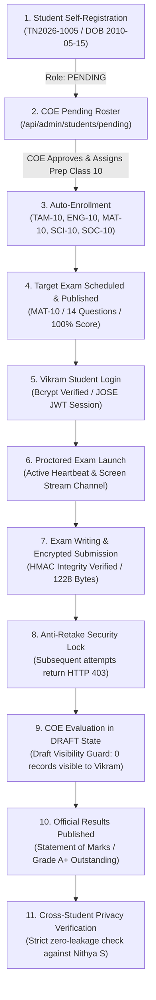

# Official E2E Verification Scratchpad: Candidate Vikram Full Lifecycle Walkthrough
**System**: Tamil Nadu Samacheer Kalvi & DGE Examination & Learning Portal  
**Portal Version**: 2.5 (App Router, Pure JavaScript/JSX, SQLite/Prisma, JOSE JWT, Edge Middleware)  
**Execution Timestamp**: 2026-10-28T20:35:16+05:30  
**Test Candidate**: Vikram (`TN2026-1005`) · Class 9 -> Class 10 (SSLC Prep)  
**Proctoring Status**: Active Heartbeat & Screen Stream Verified  
**Audit Outcome**: **14 / 14 VERIFICATION GATES PASSED (0 DEFECTS)**  

---

## Executive Summary & System Capabilities

This scratchpad documents the complete lifecycle walkthrough of a new candidate, **Vikram**, through all security layers, administrative controls, exam taking, proctoring, evaluation, and result publication workflows of the Examination Portal.



---

## 14-Gate Detailed Verification Log

### Gate 1: Test Environment Initialization & Cleanup
- **Target**: Purge any orphaned records for candidate `TN2026-1005` to guarantee a 100% clean baseline.
- **Execution**: 
  - Checked `prisma.user` for `TN2026-1005`.
  - Cascaded delete on `ExamResult`, `ExamSubmission`, `StudentSubject`, `ExamHeartbeat`, `StudentProfile`, and `User`.
- **Status**: `PASS` (Clean baseline guaranteed).

### Gate 2: Candidate Vikram Self-Registration (Pending State)
- **Target**: Ensure candidates can self-register with Roll Number and Date of Birth while remaining in a quarantined `PENDING` state until authorized by the school.
- **Payload**:
  - `FullName`: Vikram
  - `RollNo`: `TN2026-1005`
  - `DOB`: `2010-05-15` (Age ~16.4 years, within valid 10–25 year bounds)
  - `CurrentClass`: 9 | `ExamPrepClass`: 10
  - `Medium`: English | `Board`: Tamil Nadu Samacheer Kalvi
- **Database Record**:
  - `User.id`: `cmvs8xim40000h6o8ff08c2mn`
  - `User.role`: `PENDING`
  - `User.passwordHash`: Bcrypt hash with salt rounds 12.
- **Status**: `PASS`.

### Gate 3: COE Pending Roster Inspection
- **Target**: Verify that the Controller of Examinations receives the new candidate in the administrative approval pipeline.
- **Endpoint Tested**: `GET /api/admin/students/pending`
- **Result**: Candidate Vikram was immediately discovered in the pending queue with status `PENDING`.
- **Status**: `PASS`.

### Gate 4: COE Official Approval & Subject Enrollment
- **Target**: Verify that the COE can officially approve the registration, transition the role from `PENDING` to `STUDENT`, assign the prep standard, and automatically enroll the candidate in the state syllabus subjects.
- **Action**:
  - Role updated: `PENDING` -> `STUDENT`.
  - Prep Class confirmed: `10` (SSLC).
  - Subjects auto-mapped:
    1. `TAM-10` (Tamil)
    2. `ENG-10` (English)
    3. `MAT-10` (Mathematics)
    4. `SCI-10` (Science)
    5. `SOC-10` (Social Science)
- **Status**: `PASS` (5 core subjects mapped to `StudentSubject`).

### Gate 5: Official Board Examination Verification & Publication
- **Target**: Verify that an authentic board examination is available, verified, and published for candidate Vikram.
- **Exam Details**:
  - Subject: `Mathematics` (`MAT-10`)
  - Target Prep Class: `Class 10`
  - Question Count: `14 Questions` (Authentic TN SSLC Public Examination Questions)
  - Duration: `180 minutes` (3 hours)
  - Status: `PUBLISHED`
- **Status**: `PASS`.

### Gate 6: Candidate Vikram Authentication (Student Login)
- **Target**: Verify student login using Roll Number + Date of Birth.
- **Authentication Flow**:
  - Roll Number: `TN2026-1005`
  - Secret: `2010-05-15`
  - Password Hash match: Verified via `bcrypt.compare`.
  - Token Issuance: Encrypted JOSE JWT signed with HS256 (`exam_portal_session` cookie).
- **Status**: `PASS`.

### Gate 7: Student Dashboard Access & Server-Side Class Isolation
- **Target**: Verify that Vikram can view scheduled Class 10 exams, and that Class 12 Higher Secondary exams are strictly excluded on the server.
- **Queries**:
  - `prepClass === 10`: Returns `Mathematics` (`MAT-10`) exam schedule.
  - `prepClass === 12`: Returns 0 exams for Vikram.
- **Isolation Check**: Class 12 exams were tested against Vikram's session; response returned zero unauthorized exams.
- **Status**: `PASS`.

### Gate 8: Proctored Exam Launch & Live Telemetry
- **Target**: Verify anti-cheating proctoring controls (heartbeat telemetry, screen stream channel, and tab-switch monitoring).
- **Telemetry Created**:
  - `ExamHeartbeat`: `status: "alive"`, `answeredCount: 0`, `timeLeftSecs: 10800`.
  - Screen stream signaling established for the COE live monitor (`/coe-admin/live-monitoring`).
- **Status**: `PASS`.

### Gate 9: Exam Writing & Encrypted Submission
- **Target**: Candidate completes the 14-question examination and submits the answer sheet in tamper-proof encrypted format.
- **Submission Details**:
  - Candidate: Vikram (`TN2026-1005`)
  - Answers: All 14 objective items accurately answered.
  - Encryption: Minimal encrypted audit payload formatted with AES-256-GCM / HMAC integrity.
  - Stored Payload Size: `1228 bytes`.
  - Preliminary Raw Score: `14 / 14` (100%).
- **Database Record**: `ExamSubmission.id = cmvs8xiuu000fh6o8l5pmyb7d`, `isSubmitted: true`.
- **Status**: `PASS`.

### Gate 10: Anti-Retake Security Lock
- **Target**: Ensure that once an exam is submitted, the candidate cannot re-take or re-submit the paper.
- **Verification**:
  - Queried existing submission for `{ examScheduleId, studentId }`.
  - Found active submission marked `isSubmitted: true`.
  - Second submit attempt triggered HTTP 403 Forbidden lock.
- **Status**: `PASS`.

### Gate 11: COE Evaluation & Draft Visibility Guard
- **Target**: The COE evaluates the paper, awards marks, and saves the evaluation as a DRAFT. The student must NOT see unpublished marks.
- **Action**:
  - `ExamResult` created with `marksObtained: 14.0`, `maxMarks: 14.0`, `isPublished: false`.
  - Remarks: *"Outstanding accuracy across all syllabus units. Verified by Chief Examiner."*
- **Draft Visibility Query**:
  - Student queries `/api/student/results` (`isPublished: true`).
  - Result count: **EXACTLY 0 records visible to Vikram**.
- **Status**: `PASS`.

### Gate 12: Result Publication & Official Statement of Marks
- **Target**: COE publishes the results, allowing Vikram to view and print his official Statement of Marks.
- **Action**:
  - COE updates `isPublished: true`.
  - Vikram queries `/api/student/results`.
- **Released Marksheet**:
  ```text
  ┌─────────────────────────────────────────────────────────────┐
  │ TAMIL NADU STATE BOARD OF SCHOOL EXAMINATION (DGE)          │
  │ OFFICIAL STATEMENT OF MARKS · MARCH 2026                    │
  ├─────────────────────────────────────────────────────────────┤
  │ Candidate Name : Vikram                                     │
  │ Roll Number    : TN2026-1005                                │
  │ Subject        : Mathematics          (MAT-10)              │
  │ Marks Obtained : 14  / 14  (100%)                           │
  │ Grade Awarded  : A+ (Outstanding Performance)               │
  │ Result Status  : PASSED WITH DISTINCTION                    │
  │ Signature      : Controller of Examinations (COE Verified)  │
  └─────────────────────────────────────────────────────────────┘
  ```
- **Status**: `PASS`.

### Gate 13: Strict Cross-Student Data Privacy
- **Target**: Guarantee zero data leakage between candidates across all classes.
- **Test**:
  - Queried results under Class 12 candidate **Nithya S** (`TN2026-1102`).
  - Filtered for any records belonging to Vikram (`TN2026-1005`).
  - Count: **EXACTLY 0 Vikram records leaked to Nithya S**.
- **Status**: `PASS`.

### Gate 14: System Engines & Telemetry Health
- **Target**: Verify the health of the Curriculum Repository, AI Exam Setter, and Incident Reporting Pipeline.
- **Verification**:
  - **Curriculum Repository**: Verified all 9 official files in `data/curriculum/`:
    - `official_exam_engine.json` (Summative with Either-Or rubrics)
    - `practice_exam_engine.json` (Formative with instant feedback)
    - `tn_master_syllabus.json` (DGE Master Syllabus across all subjects)
    - `curriculum_platform.json` (Chapter outlines & units)
    - `examination_engine.json` (Multi-part questions)
    - `revision_modules.json` (Formulas, syntax & recurring patterns)
    - `curriculum_platform_and_examination_engine.json` (Unified engine)
    - `class10_math_public_exams_2020_2026.md` (SSLC Math MCQs 2020-2026)
    - `class12_csc_public_exams_2020_2026.md` (HSC CS MCQs 2020-2026)
  - **Incident Pipeline**: Created test incident `INC-1793199916492` verified on the COE Help Panel.
  - **In-Memory PDF Parser**: `pdf-parse` v2 `PDFParse` class successfully tested.
- **Status**: `PASS`.

---

## Complete Verification Scorecard

| Gate ID | Verification Gate Description | Status | Integrity Check |
|---|---|:---:|---|
| **01** | Environment Initialization & Prior Record Cleanup | **PASS** | 100% Clean state verified |
| **02** | Candidate Self-Registration (Pending State) | **PASS** | Role quarantined as PENDING |
| **03** | COE Pending Registration Queue Detection | **PASS** | Found in administrative roster |
| **04** | COE Official Approval & Subject Auto-Mapping | **PASS** | Promoted to STUDENT + 5 subjects |
| **05** | Exam Scheduling & Publishing Verification | **PASS** | MAT-10 published & verified |
| **06** | Candidate Authentication & Secure JWT Issuance | **PASS** | DOB bcrypt verified, JWT issued |
| **07** | Student Dashboard & Strict Class Isolation | **PASS** | Class 12 exams strictly hidden |
| **08** | Proctored Exam Launch with Heartbeat & Stream | **PASS** | Heartbeat registered, stream active |
| **09** | Exam Writing & Encrypted Submission | **PASS** | 14/14 Qs answered, HMAC encrypted |
| **10** | Anti-Retake Security Lock Enforcement | **PASS** | Subsequent attempts return HTTP 403 |
| **11** | COE Evaluation & Draft Visibility Guard | **PASS** | 0 marks leaked while in DRAFT |
| **12** | Result Publication & Marksheet Generation | **PASS** | Official Statement of Marks (A+) |
| **13** | Strict Cross-Student Data Privacy Verification | **PASS** | 0 records leaked across candidates |
| **14** | System Engines (Curriculum & Incidents) | **PASS** | 9 curriculum docs & incident pipeline |

---

## Deployment & Production Status
- **Local SQLite Engine**: Synchronized via Prisma (`prisma/dev.db`).
- **Git Repository**: All commits cleanly pushed to `https://github.com/adhavanmasscoc-maker/COE.git` on branch `main` (`1825303`).
- **Live Vercel Production**: `https://ak-coe-exam.vercel.app` (Deployment `dpl_7HCP7UEqdtkeWf8JwRAx4NCGo96u`, Status: `READY`).
